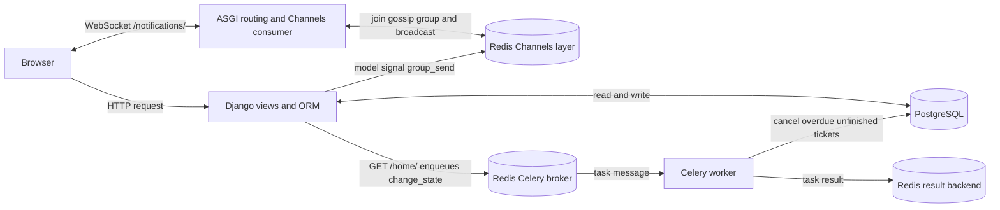

# Django Ticket Management

A Django application for user accounts, role-based ticket workflows, live notifications, and background ticket updates.

## Technology stack

| Technology | Use |
| --- | --- |
| Python 3.9 | Current project runtime. See the compatibility note below before upgrading. |
| Django 3.2.25 | HTTP views, templates, authentication, ORM, admin, and migrations. |
| PostgreSQL | Persistent account and ticket data. |
| Redis | Shared Channels message layer and Celery broker/result storage. |
| Django Channels 2.2 and channels-redis 2.4 | ASGI WebSocket notifications and cross-process message delivery. |
| Daphne 2.3 | ASGI server support for the Channels stack. |
| Celery 4.3 | Background task that marks overdue, unfinished tickets as cancelled. |
| Django REST Framework 3.12 | Serializers and REST framework support. |
| Django templates and CSS | Server-rendered interface and static styles. |

Exact package pins are in [`TicketProject/requirements.txt`](TicketProject/requirements.txt).

## Architecture



### HTTP request flow

1. The browser sends an HTTP request to Django's URL resolver.
2. Authentication decorators protect dashboard and ticket-management views. A form view validates or processes input, and the Django ORM reads or writes PostgreSQL.
3. The view returns a template or redirect. On a signed-in `GET /home/`, it also queues the `change_state` Celery task before rendering the dashboard.

### Background-task flow

1. The home view publishes a `change_state` task message to Redis; the web request does not execute the due-date scan itself.
2. A Celery worker consumes the message, queries PostgreSQL, and marks overdue tickets cancelled unless they are already done or cancelled.
3. Celery stores the task result in the configured Redis result backend. No Celery Beat schedule is configured, so a dashboard request currently triggers the scan.

### WebSocket notification flow

1. The dashboard's browser code connects to `/notifications/`.
2. Channels routes the WebSocket to `NotConsumer`, which joins the `gossip` channel group.
3. Django `post_save` and `post_delete` signals publish user/ticket events to that group through the Channels layer. Redis lets a message published by one Django process reach socket consumers in another process.

Channels/Redis is the transient message path; PostgreSQL remains the system of record. Celery's Redis broker is a separate Redis use from Channels' message layer, even though both can use one Redis server.

## HTTP routes and API surface

The project currently exposes a server-rendered Django site that submits HTML forms. Django REST Framework is installed, but there are no JSON/REST endpoints or API version prefix in the URL configuration. The routes below are mounted at the site root; `/admin/` is Django's built-in admin.

| Route | Methods used | Access / purpose |
| --- | --- | --- |
| `/` | GET | Public landing page. |
| `/register/` | GET, POST | Public registration form; assigns the selected role group. |
| `/login/` | GET, POST | Public sign-in form. |
| `/logout/` | GET or POST in current view | Signed-in user logout. |
| `/home/` | GET | Signed-in dashboard; also queues the overdue-ticket task. |
| `/listuser/` | GET | Super admin user list. |
| `/edituser/` | POST | Super admin user and role update. |
| `/deleteuser/` | POST | Super admin user deletion. |
| `/addticket/` | GET, POST | Senior system admin ticket creation. |
| `/addticketadmin/` | GET, POST | Super admin ticket creation. |
| `/listticket/` | GET | Signed-in ticket list. |
| `/view_ticket_system_admin/` | GET | Signed-in user's assigned ticket view. |
| `/editticket/` | POST | Senior system admin ticket edit and assignment handler. |
| `/editticketadmin/` | POST | Super admin ticket edit handler. |
| `/deleteticket/` | POST | Super admin ticket deletion. |
| `/edit_state_ticket_to_progress/` | POST | System admin moves a ticket to in-progress. |
| `/edit_state_ticket_to_done/` | POST | System admin marks an in-progress ticket done. |
| `/notifications/` | WebSocket | Channels connection for live notification events (not a JSON REST route). |

Forms use Django's normal session authentication and CSRF middleware. The WebSocket consumer currently accepts connections without checking authentication or origin; it sends events to every connected client in the shared `gossip` group. Add authorization and origin validation before exposing this beyond a trusted local environment.

The senior-admin and super-admin edit forms post to separate named routes (`editticket` and `editticketadmin`). The super-admin endpoint is `/editticketadmin/`, so it does not shadow the senior-admin route.

### WebSocket message events

The consumer forwards channel-layer events as JSON. Model signals currently publish these event names: `New User`, `Delete User`, `New Ticket`, `Ticket Deleted`, and `Ticket Done`. Payload fields vary by event and include a username or ticket identifier and assignment/state details when available. WebSocket notifications are transient; clients that are disconnected do not receive a replay.

### Failure behavior and current limits

| Failure | Current behavior |
| --- | --- |
| PostgreSQL unavailable | Django views and the Celery task cannot read or write application data and will error; there is no alternate database. |
| Redis unavailable | WebSocket group messaging fails. The dashboard's task dispatch can also fail before the page renders. A model signal can report an error after the database save has already occurred. |
| Celery worker unavailable | Tasks cannot run until a worker is available; the dashboard may still enqueue work if Redis accepts the message. |
| Task raises an exception | Celery records/logs the failed task. The task has no explicit retry policy or alerting. Its state update is idempotent, so a safe retry policy can be added. |
| WebSocket disconnects | Live events are not persisted or replayed for disconnected clients. The current browser code does not provide visible reconnect/error handling. |

For a production design, move task dispatch to robust service boundaries, use transaction-aware event publication (`transaction.on_commit`), add bounded retries and monitoring, secure WebSocket access/origin checks, and add durable replay if missed notifications matter. A scheduled Celery Beat job would remove the current dependency on dashboard traffic for due-date scans.

## Safe local setup

The commands below use macOS and Homebrew. Keep `.env` local; it is ignored by Git. Never commit real secrets or expose the development server to a public network.

Install the services:

```bash
brew install postgresql redis
brew services start postgresql
brew services start redis
```

Create the local environment file and replace both placeholder values. Generate the Django secret with `openssl rand -hex 32`; choose a local-only PostgreSQL password and set the same value in the role below and `.env`.

```bash
cp .env.example .env
```

Create the role and database using the values you chose in `.env` (replace the sample role name and password with those values):

```bash
psql postgres
```

At the `psql` prompt, run:

```sql
CREATE ROLE ticket_app WITH LOGIN PASSWORD 'choose-a-local-password';
CREATE DATABASE ticket_management OWNER ticket_app;
\q
```

If the role or database already exists, skip creating that item. To update the role password, run `ALTER ROLE ticket_app WITH PASSWORD 'choose-a-local-password';` inside `psql`.

Export the environment values for the remaining setup and run commands:

```bash
set -a
source .env
set +a
```

Create the virtual environment and install the pinned packages:

```bash
cd TicketProject
python3.9 -m venv .venv
source .venv/bin/activate
python -m pip install "pip==24.0" "setuptools<58" wheel
pip install --no-build-isolation -r requirements.txt
```

Load the environment file in each terminal used to run Django or Celery:

```bash
set -a
source ../.env
set +a
```

Initialize and run the web app:

```bash
python manage.py migrate --settings=TicketProject.settings.local
python manage.py runserver --settings=TicketProject.settings.local
```

Open <http://127.0.0.1:8000/>. Register at `/register/`, then sign in at `/login/`. For live notifications and background work, keep Redis running and start a worker in another terminal from `TicketProject` with the virtual environment activated and `.env` sourced:

```bash
celery -A TicketProject worker --loglevel=info
```

## Automated tests

Run the Django test suite from `TicketProject` after activating the virtual environment and sourcing `../.env`:

```bash
DJANGO_TEST_SQLITE=true python manage.py test user_management --settings=TicketProject.settings.local
```

The suite covers public pages, registration and role assignment, login and dashboard access, distinct senior-admin and super-admin ticket edit route resolution, the overdue-ticket task, and a Channels consumer receiving a group event. The task test executes the Celery task synchronously; it does not need a worker. The command uses a temporary SQLite test database and an in-memory Channels layer, so it does not need PostgreSQL, Redis, or database creation privileges. Omit `DJANGO_TEST_SQLITE=true` to run the suite against PostgreSQL; the configured database role then needs permission to create test databases.

### CI and linting

GitHub Actions runs on pushes and pull requests. It installs the pinned runtime dependencies and development linter, checks dependency consistency with `pip check`, runs the Django system check and test suite, and runs Flake8. `.flake8` currently gates syntax errors and high-confidence undefined-name/control-flow errors while the older codebase is being modernized; it excludes generated migrations. Run the same checks locally from `TicketProject`:

```bash
pip install -r ../requirements-dev.txt
python -m pip check
flake8 . --count
python manage.py check --settings=TicketProject.settings.local
DJANGO_TEST_SQLITE=true python manage.py test user_management --settings=TicketProject.settings.local
```

### Dependency management

`TicketProject/requirements.txt` is the pinned runtime set, including transitive pins retained for the Python 3.9 environment. `requirements-dev.txt` pins the linter and its dependencies. Update these files deliberately, in a clean virtual environment; after changing a runtime dependency, rerun `pip check`, the Django checks, the test suite, and the WebSocket/worker smoke checks. Avoid ad hoc package upgrades in an active environment. The GitHub Actions workflow uses the same runtime pins and test command as local development.

## Dependency compatibility and upgrade path

This repository currently targets Python 3.9 and an older dependency stack. Python 3.9 reached end-of-life in October 2025, and Django 3.2 ended extended support in April 2024. Django 4.2 was the last series supporting Python 3.9 and also ended support in April 2026. Django 5.2 requires Python 3.10 or newer; prefer Python 3.11 or newer because Python 3.10 support ends in October 2026. Channels 4.3 supports the newer Django generation but is a major upgrade from Channels 2 and requires coordinated Channels, Daphne, and `channels-redis` changes. Celery 5.6 supports Python 3.9 and Django 2.2+, but this project also has legacy task configuration and dependencies.

The active virtual environment is Python 3.9.6, so I retained the pins in this change instead of partially upgrading Django and making the current environment unusable. `pip check` reports no broken requirements, though installing Celery 4.3 emits a deprecation warning for its old package metadata. Plan a separate upgrade on Python 3.11+ to a maintained Django LTS, then upgrade Channels/Daphne/`channels-redis` together and Celery/Redis together. Run the full test suite and verify WebSocket delivery and worker task execution as part of that upgrade. Compatibility references: [Django/Python support](https://docs.djangoproject.com/en/5.2/faq/install/), [Django release support schedule](https://www.djangoproject.com/download/), [Python version status](https://devguide.python.org/versions/), [Channels 4 release notes](https://channels.readthedocs.io/en/latest/releases/4.3.0.html), and [Celery 5.6 release notes](https://docs.celeryq.dev/en/stable/history/whatsnew-5.6.html).

## Notes

- `TicketProject/settings/local.py` requires environment variables for the Django secret key and PostgreSQL credentials. Missing required variables cause startup to fail instead of falling back to committed credentials.
- Local settings enable `DEBUG` only when `DJANGO_DEBUG` is set to a truthy value. Use a generated secret and `DEBUG=false` outside local development.
- Run Django management commands from `TicketProject` and pass `--settings=TicketProject.settings.local`.
